# Kotlin PlantUML Generator

> A **KSP-Processor** that generates **PlantUML** code from **Kotlin source files** to help you create **accurate, up-to-date UML diagrams** for your project.

---

## 📦 Overview

This Processor is designed to automatically generate **PlantUML** code from your Kotlin codebase using the **Kotlin Symbol Processing API (KSP)**. The generated `.puml` files can be rendered using tools like `plantuml`, online editors, or IDE integrations.

The project is **open source**, **privacy-focused**, and **highly customizable**, allowing you to control what parts of your code are included in the diagrams.

---

## 🎯 Purpose

- Provide a **clear overview** of your Kotlin class structure.
- Help **API readers** quickly understand class relationships.
- Ensure **diagrams stay up to date** with your codebase.
- Avoid **data privacy issues** by not sending any user data to third parties.

---

## 🔧 Features

- ✅ **KSP-based symbol processing** for accurate Kotlin code analysis.
- ✅ **Customizable configuration** (e.g., visibility filters, name exclusions, package grouping, ...).
- ✅ **Integrated with Gradle** — runs on every build.
- ✅ **Privacy-first** — only generates `.puml` code, no data is sent to third parties.
- ✅ **Open source** — contribute and extend the plugin!

---

## 📌 Supported Kotlin Features

- Sealed classes
- Object declarations
- companion objects
- Suspend functions
- Extension functions
- Visibility modifiers (public, internal, private)
- Custom filtering of elements by name or package
- Presets to filter the classes that are generated by Hilt, Dagger and Room
- Collection element type resolving
- Generic element type resolving
- The notation of UML class diagrams as alternative to the default notation of Plantuml
- ...

---

### ⚒️ Try it out

1. Clone this Repository.
2. Run `./gradlew :example:kspKotlin` to generate a Plantuml Classdiagram.  
3. The output can be found at `example/build/resources/main/ClassDiagram.puml`.  

The generated file can be rendered by using the Intellij Plantuml Plugin or on [Plantuml.com](https://plantuml.com/)

---

## 🚀 Getting Started

### 📦 1. Installation

Add the KSP-Plugin and the Processor to your `build.gradle.kts`:

```kotlin
plugins {
    id("com.google.devtools.ksp") version "2.3.3"
}

dependencies {
    ksp("io.github.tosaa.puml.ksp:ksp-plantuml-generator:0.0.+")
}

```

### ▶️ 2. **Run the Gradle Task**

Run the following command to generate PlantUML code:

```bash
./gradlew :<modulename>:kspKotlin
```

> This will generate `.puml` file in the `<modulename>/build/generated/ksp/main/resources` directory by default.

### 🎨 3. **Render the Diagrams**

#### 🥇🥇🥇Recommended way: Do it locally 🥇🥇🥇  
_(hence it supports maximum privacy and offline compatibility)_

Download the `plantuml.jar` and make use of CLI commands

- [plantuml.jar](https://plantuml.com/download)
- [CLI commands overview](https://plantuml.com/command-line)

To generate the diagram the following command can be used.  

`java -jar plantuml.jar <modulename>/build/generated/ksp/main/resources -svg`

Quote from the docs:
> If you provide a relative path then the images is placed in that directory relative to the location of the input file, not the current directory (note: this applies even if the path begins with a .). When Plantuml processes files from multiple directores then the corresponding directory structure is created under the computed output directory.

#### 🥈🥈🥈 Good for playing around: Do it online 🥈🥈🥈  
_(Be aware that you share your diagram with a 3rd party)_

Use the [Plantuml online editor](https://www.plantuml.com/plantuml/uml) and copy and paste your diagram into it.

#### 🥉🥉🥉Other options: 🥉🥉🥉  
Here are a few more options that can be used to render the diagram:
- Use Plantuml integrations for editors and IDEs
- Host your own plantuml server via docker -> [Instructions](https://plantuml.com/starting)
- [Many more options](https://plantuml.com/running) are supported by the Plantuml Community


---

## 🛠️ Configuration

You can customize the plugin's behavior by 
passing a customized KSP configuration within the Kotlin-DSL 
or writing a configuration file 
and setup a custom gradle task.

### Example Configuration by configuration file
1. Define all required options in a file

MyConfig.conf
```
# comment
; comment
puml.allowEmptyPackage=true
```

2. Reference the file in a custom gradle task

```kotlin
tasks {
    register("generatePlantumlWithMySettings") {
        ksp {
            arg("puml.configFilePath", layout.projectDirectory.file("myConfig.conf").asFile.path)
        }
        dependsOn("kspKotlin")
    }
}
```

The configuration file is based on the [INI file schema](https://en.wikipedia.org/wiki/INI_file).
- Lines beginning with ; and # are interpreted as comments
- key and value settings are separated with '='
- Packages and Names can be separated with ','
- Boolean settings can be set with 'true' and 'false'

### Example Configuration within Kotlin-DSL

```kotlin
val customizedPlantumlConfiguration = mutableMapOf<String, String>().apply {
    // add all your settings here
    put("puml.allowEmptyPackage", "true")
}

tasks {
    register("generatePlantumlWithMySettings") {
        ksp {
            customizedPlantumlConfiguration.forEach {
                arg(it.key, it.value)
            }
        }
        dependsOn("kspKotlin")
    }
}
```

---

## 📚 Configuration Guide

### Configuration Templates

- [Default configuration](doc/default.conf) as .conf file _- is always a good way to start_
- [Public API configuration](doc/publicAPI.conf) as .conf file _- probably the best suitable configuration when you want to visualize your library_

<details>
<summary>KSP configuration for public API</summary>

```

val visualizePublicAPIConfiguration = mutableMapOf<String, String>().apply {
    put("puml.title", "Public API")
    put(
        "puml.prefix", """
skinparam class {
    BackgroundColor #fdf0d5
    classFontSize 16
    ArrowColor 003049
    BorderColor 003049
    FontColor 003049
    FontSize 20
}
    """.trimMargin()
    )
    
    put("puml.excludedFunctionNames", "<init>,equals,hashCode,toString")
    put("puml.showVisibilityModifiers", "false")
    // Only keep public API
    put("puml.showPublicClasses", "true")
    put("puml.showPublicProperties", "true")
    put("puml.showPublicFunctions", "true")
    // Hide internal and private 
    put("puml.showInternalClasses", "false")
    put("puml.showInternalProperties", "false")
    put("puml.showInternalFunctions", "false")
    put("puml.showPrivateClasses", "false")
    put("puml.showPrivateProperties", "false")
    put("puml.showPrivateFunctions", "false")
    // Actively show inheritance but skip property/function relations
    put("puml.showInheritance", "true")
    put("puml.showPropertyRelations", "true")
    put("puml.showFunctionRelations", "false")
    put("puml.showIndirectRelations", "true")
    // Show packages since they might be helpful for the API consumer
    put("puml.showPackages", "true")
    put("puml.allowEmptyPackage", "false")
}

ksp {
    // Add all configured options to the KSP environment
    visualizePublicAPIConfiguration.forEach {
        arg(it.key, it.value)
    }
}
```


</details>

### List of Configuration Options

The following options can be set.

Key | Default                                              | Description
--|------------------------------------------------------|--
`puml.includedPackages` | `emptyList`                                          | If nothing is specified, all packages are taken into account for the generation.
`puml.excludedPackages` | `emptyList`                                          | Exclude packages that would be included otherwise.
`puml.excludedClassNames` | `emptyList`                                          | Exclude classes by name
`puml.excludedClassNamePrefixes` | `emptyList`                                          | Exclude classes whose name starts with one of the given prefixes
`puml.excludedClassNameSuffixes` | `emptyList`                                          | Exclude classes whose name ends with one of the given suffixes
`puml.excludedClassNameContains` | `emptyList`                                          | Exclude classes whose name contains one of the given fragments
`puml.filterPreset` | `NONE`                                               | Exclude the classes that are generated by a framework: `NONE`, `HILT_DAGGER`, `ROOM` or `ANDROID_GENERATED`. See [Presets for generated classes](#presets-for-generated-classes)
`puml.excludedPropertyNames` | `emptyList`                                          | Exclude variables by name
`puml.excludedFunctionNames` | `listOf("<init>", "toString", "equals", "hashCode")` | Exclude functions by name
`puml.allowEmptyPackage` | `false`                                              | Allow/Deny classes without a package
`puml.notation` | `PLANTUML`                                           | The notation in which the diagram is drawn: `PLANTUML` or `UML`. See [Notation](#notation)
`puml.showVisibilityModifiers` | `true`                                               | Show/Hide visiblity modifiers indicated by +/#/-, and ~ in the notation `UML`
`puml.markExtensions` | `true`                                               | Show/Hide information that a variable/function is an extension variable / function
`puml.showExtensions` | `true`                                               | Show/Hide extension variables / function
`puml.showPublicClasses` | `true`                                               | Allow/Ignore public classes
`puml.showPublicProperties` | `true`                                               | Allow/Ignore public variables
`puml.showPublicFunctions` | `true`                                               | Allow/Ignore public functions
`puml.showInternalClasses` | `true`                                               | Allow/Ignore internal classes
`puml.showInternalProperties` | `true`                                               | Allow/Ignore internal variables
`puml.showInternalFunctions` | `true`                                               | Allow/Ignore internal functions
`puml.showPrivateClasses` | `true`                                               | Allow/Ignore private classes
`puml.showPrivateProperties` | `true`                                               | Allow/Ignore private variables
`puml.showPrivateFunctions` | `true`                                               | Allow/Ignore private functions
`puml.showJavaObjectMembers` | `false`                                              | Show/Hide the functions that every class inherits from `java.lang.Object` and every enum from `java.lang.Enum`, like `getClass`, `wait` or `clone`
`puml.showGeneratedMembers` | `false`                                              | Show/Hide the members that are generated by the compiler: `values`, `valueOf`, `entries`, `name` and `ordinal` of enums, `copy` and `componentN` of data classes
`puml.showInheritance` | `true`                                               | Show Inheritance of classes by drawing Arrows
`puml.showPropertyRelations` | `true`                                               | Show Relations of variables by drawing Arrows when the type could be resolved and is shown as class in the diagram
`puml.showFunctionRelations` | `false`                                              | Show Relations of functions by drawing Arrows when the return type of the function could be resolved and is shown as class in the diagram. Parameters of the function are not drawn.
`puml.showIndirectRelations` | `true`                                               | Show Relations of functions and properties that are resolved indirectly. E.g. the type of the elements that are contained in a list or the type argument of a `Result`.
`puml.maxRelations` | `6`                                                  | Sets the limit when relations of a class should not be drawn anymore. If a class has more relations that the given value, the classes relations will not be shown. The default value is set to 6.
`puml.showPackages` | `false`                                              | Group classes that are in the same package
`puml.prefix` | ``                                                   | Add a custom prefix to the plantuml diagram
`puml.postfix` | ``                                                   | Add a custom postfix to the plantuml diagram
`puml.title` | ``                                                   | Add a custom title to the plantuml diagram
`puml.outputFileName` | ``                                                   | Set custom file within /build/generated/ksp/main/resources
`puml.configFilePath` | ``                                                   | Apply config file with all above described configurations
`puml.saveLogToFile` | ``                                                   | Save log of KSPProcessor to logfile. Mostly interesting for later analysis why elements are rendered or not rendered

### Presets for generated classes

Frameworks like Hilt, Dagger and Room generate classes into the packages of your own classes. Therefore they cannot be excluded with `puml.excludedPackages`.
`puml.filterPreset` excludes them by their name:

Preset | Excluded classes
--|--
`NONE` | No class
`HILT_DAGGER` | Classes whose name starts with `Hilt_`, ends with `_Factory`, `_MembersInjector`, `_GeneratedInjector`, `_AssistedFactory` or `InstanceHolder` or contains `_HiltModules`, `_HiltComponents` or `_Provide`
`ROOM` | Classes whose name ends with `Dao_Impl` or `Database_Impl`
`ANDROID_GENERATED` | The classes of `HILT_DAGGER` and `ROOM` and the classes of view binding, whose name ends with `Binding`

- A class of your own with a matching name is excluded as well.
- `puml.excludedClassNames`, `puml.excludedClassNamePrefixes`, `puml.excludedClassNameSuffixes` and `puml.excludedClassNameContains` are applied in addition to the preset.
- Hilt generates further classes into the package `hilt_aggregated_deps`, which can be excluded with `puml.excludedPackages`.

---

## 📚 Examples

### Notation
`puml.notation` selects the notation in which the diagram is drawn:
- `PLANTUML` (default) keeps the notation of the earlier versions, which relies on the defaults of Plantuml.
- `UML` uses the notation of UML class diagrams.

The notation decides how the elements and the relations are drawn, not which of them are drawn.

Part of the diagram | `PLANTUML` | `UML`
--|--|--
Kind of an element | Circled character, e.g. `C` for a class or `I` for an interface | Keyword: `<<interface>>` or `<<enumeration>>`
Visibility of a member | Icon, internal and package private members are drawn as protected | `+` (public), `-` (private), `#` (protected) or `~` (internal or package private)
Function | `name(Type) : ReturnType` | `name(parameter : Type) : ReturnType`, a `vararg` parameter has the multiplicity `[*]`
Extension, suspend function | `<ext>`, `suspend` | Stereotypes `<<ext>>`, `<<suspend>>`
Relations | Diamonds for properties, see [Many types of relations example](#many-types-of-relations-example) | Associations and dependencies, see [Many types of relations example](#many-types-of-relations-example)

In both notations static members are underlined and modifiers of Kotlin are stereotypes, e.g. `<<Data>>`, `<<Sealed>>` or `<<object>>`.

The notation `UML` starts every diagram with `hide circle` and `skinparam classAttributeIconSize 0`, which replace the circled characters and the visibility icons of Plantuml.
`puml.prefix` is written behind these settings and can override them, e.g. with `show circle`.

### DataClass example
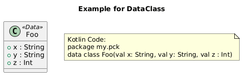

### Companion object example
No additional `Class.Companion` entry is added but companion variables and functions are declared as static for the owning `class`.

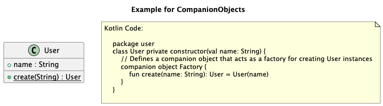

### Enums example

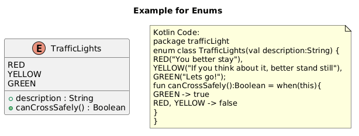

### TypeAlias example

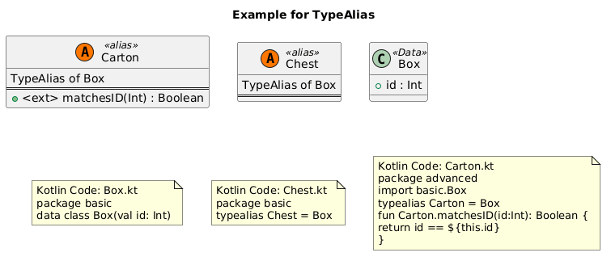

### Extensions example
Extension variables and functions can be marked as `<ext>`, or with the stereotype `<<ext>>` in the notation `UML`. Extensions of the Companion object are marked as static as well.

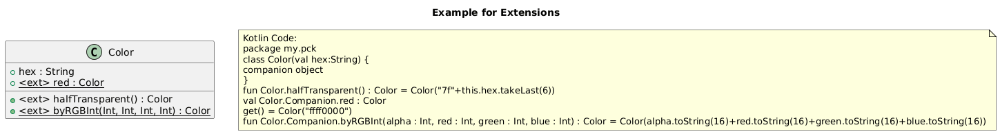

If extension variables and extension functions of classes from dependencies are implemented, their classes are displayed in a concise format.
This approach prevents the diagram from becoming cluttered by including all variables, methods, and inner classes from dependency classes.

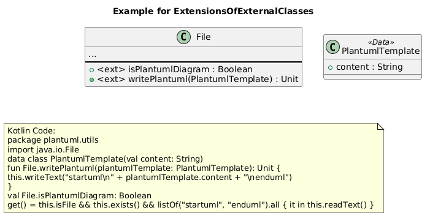

### Interface example

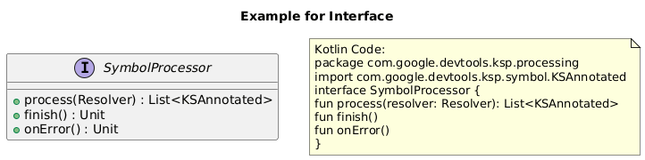

### Inheritance example

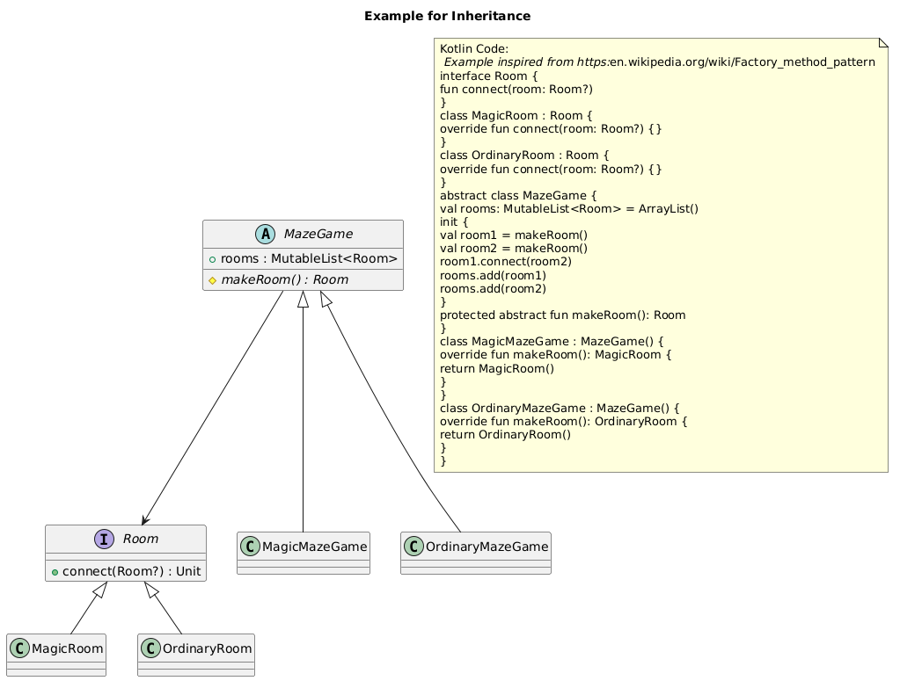

### Objects example
Since `object` is equal to Singleton in Kotlin, it is highlighted with a red indicating color and the tag `<<object>>`. The notation `UML` hides the circled characters, therefore it marks an object with the tag only.

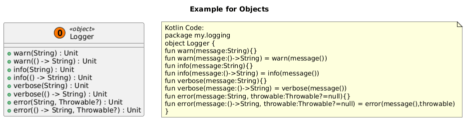

### Sealed classes example

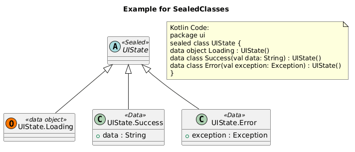

### Suspend functions example
Since coroutines and the concept of `suspend` functions is a very important detail in Kotlin, suspend functions can be marked as such in the final diagram as well. 

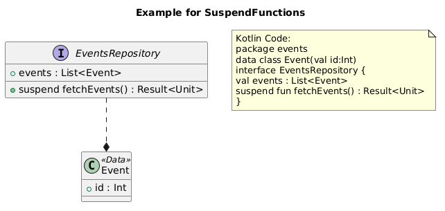

### Many types of relations example
Indirect relations like the Type of elements in a List or the Type of Result can be resolved too.

Code | `PLANTUML` | `UML`
--|--|--
A class extends a class or an interface extends an interface | `Parent <\|-- Child` solid line ending with a hollow triangle | Generalization: `Parent <\|-- Child` solid line ending with a hollow triangle
A class or an object implements an interface | `Interface <\|-- Class` solid line ending with a hollow triangle | Realization: `Interface <\|.. Class` dotted line ending with a hollow triangle
A property has the type of another class | `Owner --* Type` solid line ending with a diamond | Association with the multiplicity `1`, or `0..1` if the property is nullable: `Owner --> "1" Type` solid line ending with an arrow
A property is a collection or an array of another class | `Owner ..* Type` dotted line ending with a diamond | Association with the multiplicity `*`: `Owner --> "*" Type` solid line ending with an arrow
The type of a property refers to another class as type argument, e.g. `Result<Type>` | `Owner ..* Type` dotted line ending with a diamond | Dependency: `Owner ..> Type` dotted line ending with an arrow
A function returns another class | `Owner --> Type` solid line ending with an arrow | Dependency: `Owner ..> Type` dotted line ending with an arrow
The return type of a function refers to another class as type argument | `Owner ..> Type` dotted line ending with an arrow | Dependency: `Owner ..> Type` dotted line ending with an arrow

- The notation `UML` uses neither aggregation nor composition, since the source code does not tell whether a class owns the objects it refers to.
- If there is more than one relation between two classes, only one of them is drawn. Inheritance comes first, then `PLANTUML` prefers direct relations to indirect ones and `UML` prefers associations to dependencies.

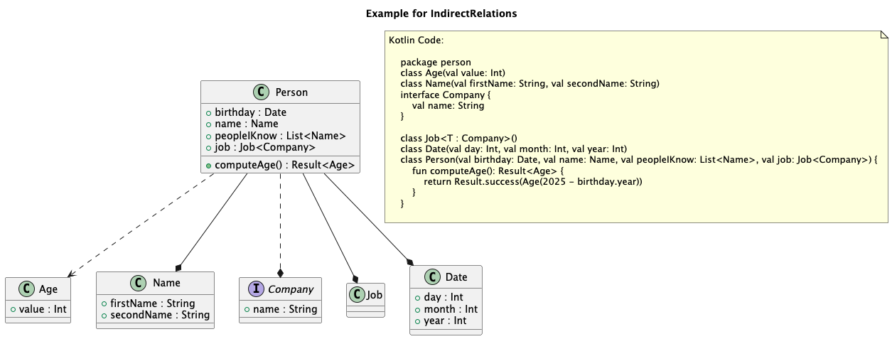

If a class has to many relations the diagram can get very hard to read.
Instead all relations will be hidden and a note will be added.

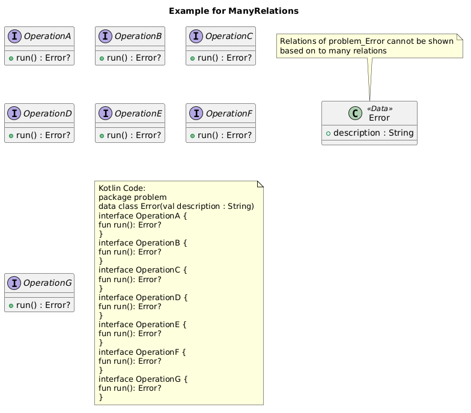

---

## 📥 Contributing & 📧 Contact


If you have any questions, feature requests, or need help, feel free to report these as an [issue](https://github.com/Tosaa/ksp-plantuml/issues).

**Open Topics & Ideas:**

- Create Option to hide Relations for given classes
- Create Option to generated output file to given path
- Bug: Indirect Relations do not exclude classes that are not in included packages

---

## 📋 Changelog

Please check the [Changelog file](https://github.com/Tosaa/ksp-plantuml/blob/main/CHANGELOG.md) to see the changes of the latest releases.

---

## 📌 License

This project is licensed under the **Apache License, Version 2.0** — see the [LICENSE](LICENSE) file for details.

---
